<div align="center">

# CRE-Agent

**Automated Commercial Real Estate Invoice Extraction, Deterministic Math Verification & GL Coding**

[](https://github.com/jaypiasco/cre-agent/actions/workflows/ci.yml)


[Architecture](#architecture) • [Guardrails](#key-engineering-guardrails) • [Quick Start](#quick-start) • [API](#api-endpoints) • [Deployment](#deployment)

</div>

---

CRE-Agent automates Commercial Real Estate (CRE) Accounts Payable workflows. It ingests text or scanned vendor PDF invoices, extracts structured line items via multimodal LLMs, enforces deterministic `Decimal` arithmetic gates, recommends General Ledger (GL) codes, traces every call in Langfuse, and gates Yardi-ready batch exports behind explicit Human-in-the-Loop (HITL) approval.

> [!IMPORTANT]
> Export endpoints strictly block Yardi CSV and audit JSON generation until **Human Approval** is explicitly toggled on in the HITL workbench.

## Architecture



<sub>Source: <a href="./docs/diagrams/architecture.html">Interactive HTML diagram</a></sub>

## Key Engineering Guardrails

- **Cost-Aware Multimodal Routing**: Text-based PDFs route to fast structured extraction; scanned or image-only PDFs automatically escalate to Vision mode via PyMuPDF PNG rendering (capped at 5 pages, 150 DPI). Supports **Google Gemini** (`gemini-3.8-flash`), **OpenAI** (`gpt-6-luna` / `gpt-6.2-sol`), **Anthropic** (`claude-haiku-5-5` / `claude-sonnet-5-5`), and an offline **`mock`** provider.
- **Deterministic Math Gate**: Uses `Decimal` arithmetic to verify line-item multiplication (`quantity * unit_price == line_total`), subtotal consistency, and grand total (`sum(line_items) + tax - discount == amount_due` within `±$0.02`), paired with required-field checks and a `90%` extraction confidence threshold.
- **Human-in-the-Loop (HITL) Gate**: `/api/v1/invoices/export` and the Next.js + shadcn/ui workbench enforce manual sign-off before emitting Yardi-compatible payloads.
- **Observability & Golden Evals**: Every run creates a parent Langfuse trace with `invoice_extraction` and `gl_coding_match` generation spans (falling back to structured local logs when Langfuse keys are omitted), verified by `scripts/eval_pipeline.py`.

## Evaluation Results

| Sample PDF | Mode | Expected GL | Gate Status | Scenario |
| :--- | :--- | :--- | :--- | :--- |
| `hvac_apex_inv_88412.pdf` | `text` | `6100` | `VALID` | Clean text-based HVAC invoice |
| `roofing_summit_scr_4419.pdf` | `text` | `6200` | `VALID` | Clean text-based roofing invoice |
| `landscaping_greenview_scanned.pdf` | `vision` | `6300` | `NEEDS_REVIEW` | Scanned image-only PDF triggering Vision + confidence review |
| `utility_math_error_sample.pdf` | `text` | `6500` | `NEEDS_REVIEW` | Intentional `+$150.00` mismatch caught by deterministic math gate |

## Quick Start

> [!TIP]
> Set `LLM_PROVIDER=mock` in `.env` to run the full end-to-end pipeline and sample evaluations without external API keys.

### Docker Compose (Recommended)

```bash
cp .env.example .env
docker compose up --build
```

- **Next.js Workbench**: `http://localhost:3000`
- **FastAPI Swagger Docs**: `http://localhost:8000/docs`

### Local Development

#### Backend (`app/`)

```bash
python -m venv .venv
# Windows (PowerShell): .\.venv\Scripts\Activate.ps1
# macOS / Linux:        source .venv/bin/activate
pip install -r requirements.txt
cp .env.example .env
python scripts/generate_samples.py
uvicorn app.main:app --reload
```

#### Frontend (`frontend/`)

```bash
cd frontend
npm ci
npm run dev
```

> [!NOTE]
> A lightweight Streamlit alternative is also available via `streamlit run ui/streamlit_app.py`.

## Verification

```bash
ruff check app scripts tests
pytest -v
python scripts/eval_pipeline.py --provider mock
cd frontend && npm run lint && npm run build
```

## API Endpoints

| Method | Endpoint | Description |
| :--- | :--- | :--- |
| `GET` | `/health` | Service health, active LLM provider, and Langfuse status |
| `GET` | `/api/v1/chart-of-accounts` | CRE Chart of Accounts (`5100`–`7100`) |
| `POST` | `/api/v1/invoices/analyze` | Multipart PDF upload → extraction, math gate, and GL coding |
| `POST` | `/api/v1/invoices/export` | HITL-gated Yardi CSV & JSON audit payload generator |

## Deployment

See [docs/DEPLOYMENT.md](docs/DEPLOYMENT.md) for step-by-step deployment instructions:

- **FastAPI Backend**: AWS App Runner (via Amazon ECR)
- **Next.js Frontend**: Vercel
- **Observability**: Langfuse Cloud

## Project Structure

```text
cre-agent/
├── app/
│   ├── main.py                  # FastAPI application & endpoints
│   ├── config.py                # Pydantic settings (.env)
│   ├── models.py                # Pydantic v2 schemas
│   ├── data/
│   │   └── chart_of_accounts.json
│   └── services/
│       ├── pdf_parser.py        # PyMuPDF text extraction + Vision PNG fallback
│       ├── llm_client.py        # Gemini / OpenAI / Anthropic / Mock + Langfuse
│       ├── validator.py         # Deterministic Decimal math & field gates
│       └── exporter.py          # HITL-gated Yardi CSV/JSON formatter
├── frontend/                    # Next.js App Router + TypeScript + shadcn/ui
├── scripts/
│   ├── generate_samples.py      # Generates 4 sample CRE vendor PDFs
│   └── eval_pipeline.py         # Golden evaluation harness across samples
├── tests/
│   ├── test_validator.py        # Arithmetic & validation edge-case tests
│   └── test_api.py              # FastAPI endpoint & HITL gate tests
├── docs/
│   ├── DEPLOYMENT.md            # AWS App Runner + Vercel deployment guide
│   └── diagrams/                # Architecture diagram (HTML + SVG)
├── Dockerfile
└── docker-compose.yml
```
