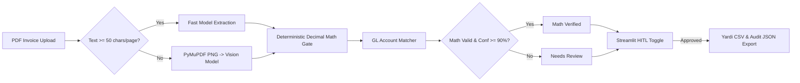

# CRE-Agent: Automated Invoice Extraction & GL Coding Assistant

A production-grade Proof-of-Concept (POC) for **Commercial Real Estate (CRE) Accounts Payable automation**—ingesting vendor PDF invoices (text or scanned), extracting structured data via LLM structured outputs, enforcing deterministic arithmetic gates, recommending General Ledger (GL) codes, tracing every call in Langfuse, and gating Yardi-ready batch export behind explicit Human-in-the-Loop (HITL) approval.

## Architecture



## Key Engineering Guardrails

- **Cost-Aware Multimodal Routing:** Text-based PDFs route to fast, low-cost models (`gpt-4o-mini` / `claude-3-5-haiku-latest`); scanned or image-only PDFs automatically escalate to Vision models (`gpt-4o` / `claude-3-5-sonnet-latest`) via PyMuPDF PNG rendering (capped at 5 pages, 150 DPI).
- **Deterministic Anti-Hallucination Math Gate:** Uses `Decimal` arithmetic to verify line-item multiplication (`quantity * unit_price == line_total`), subtotal consistency, and grand total (`sum(line_items) + tax - discount == amount_due` within `±$0.02`), paired with required-field checks and a `90%` extraction confidence threshold.
- **Human-in-the-Loop (HITL) Gate:** The `/api/v1/invoices/export` endpoint and Streamlit UI strictly block Yardi CSV/JSON export unless `human_approved` is explicitly toggled on.
- **Observability:** Every analysis creates a parent Langfuse trace with `invoice_extraction` and `gl_coding_match` generation spans (gracefully falling back to structured local logging when Langfuse keys are omitted).

## Quick Start

### 1. Clone & Install

```bash
git clone https://github.com/<your-username>/cre-agent.git
cd cre-agent
python -m venv .venv
```

Activate the virtual environment and install dependencies:

```powershell
# Windows (PowerShell)
.\.venv\Scripts\Activate.ps1
pip install -r requirements.txt
```

```bash
# macOS / Linux
source .venv/bin/activate
pip install -r requirements.txt
```

### 2. Configure Environment

```bash
cp .env.example .env
```

- **Live LLM Mode:** Set `LLM_PROVIDER=openai` (with `OPENAI_API_KEY`) or `LLM_PROVIDER=anthropic` (with `ANTHROPIC_API_KEY`). Optionally add `LANGFUSE_PUBLIC_KEY` and `LANGFUSE_SECRET_KEY`.
- **Offline Demo Mode (No API Key Required):** Set `LLM_PROVIDER=mock` in `.env` to test the full end-to-end pipeline and UI with realistic CRE invoice responses.

### 3. Generate Sample PDFs & Run Tests

```bash
python scripts/generate_samples.py
pytest -v
```

### 4. Launch Backend & UI

Terminal 1 — FastAPI backend:
```bash
uvicorn app.main:app --reload
```

Terminal 2 — Streamlit HITL workbench:
```bash
streamlit run ui/streamlit_app.py
```

## API Endpoints

| Method | Endpoint | Description |
| :--- | :--- | :--- |
| `GET` | `/health` | Service health, active LLM provider/models, and Langfuse status |
| `GET` | `/api/v1/chart-of-accounts` | Mock CRE Chart of Accounts (`5100`–`7100`) |
| `POST` | `/api/v1/invoices/analyze` | Multipart PDF upload -> extraction, math gate, and GL coding |
| `POST` | `/api/v1/invoices/export` | HITL-gated Yardi CSV & JSON audit payload generator |

## Project Structure

```text
cre-agent/
├── app/
│   ├── main.py                  # FastAPI application & endpoints
│   ├── config.py                # Pydantic settings (.env)
│   ├── models.py                # Pydantic v2 schemas
│   ├── data/
│   │   └── chart_of_accounts.json
│   └── services/
│       ├── pdf_parser.py        # PyMuPDF text extraction + Vision PNG fallback
│       ├── llm_client.py        # OpenAI / Anthropic / Mock + Langfuse tracing
│       ├── validator.py         # Deterministic Decimal math & field gates
│       └── exporter.py          # HITL-gated Yardi CSV/JSON formatter
├── ui/
│   └── streamlit_app.py         # Streamlit HITL review workbench
├── scripts/
│   └── generate_samples.py      # Generates 3 sample CRE vendor PDFs
├── tests/
│   ├── test_validator.py        # Arithmetic & validation edge-case tests
│   └── test_api.py              # FastAPI endpoint & HITL gate tests
├── SPEC.md                      # Original technical & functional specification
├── requirements.txt
└── .env.example
```
