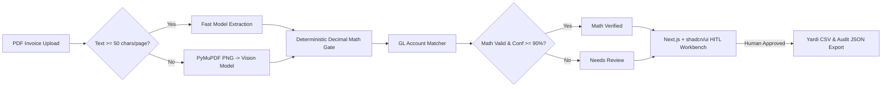

# CRE-Agent: Automated Invoice Extraction & GL Coding Assistant

[](https://github.com/johnp/cre-agent/actions/workflows/ci.yml)


A production-grade full-stack AI engineering system for **Commercial Real Estate (CRE) Accounts Payable automation**—ingesting vendor PDF invoices (text or scanned), extracting structured data via multimodal LLM structured outputs, enforcing deterministic `Decimal` arithmetic gates, recommending General Ledger (GL) codes, tracing every call in Langfuse, and gating Yardi-ready batch export behind explicit Human-in-the-Loop (HITL) approval.

---

## Architecture



## Key Engineering Guardrails

- **Cost-Aware Multimodal Routing:** Text-based PDFs route to fast, low-cost extraction; scanned or image-only PDFs automatically escalate to Vision mode via PyMuPDF PNG rendering (capped at 5 pages, 150 DPI). Supports **Google Gemini** (`gemini-3.8-flash`), **OpenAI** (`gpt-6-luna` / `gpt-6.2-sol`), **Anthropic** (`claude-haiku-5-5` / `claude-sonnet-5-5`), and an offline **`mock`** provider.
- **Deterministic Anti-Hallucination Math Gate:** Uses `Decimal` arithmetic to verify line-item multiplication (`quantity * unit_price == line_total`), subtotal consistency, and grand total (`sum(line_items) + tax - discount == amount_due` within `±$0.02`), paired with required-field checks and a `90%` extraction confidence threshold.
- **Human-in-the-Loop (HITL) Gate:** The `/api/v1/invoices/export` endpoint and Next.js workbench strictly block Yardi CSV/JSON export unless **Human Approval** is explicitly toggled on.
- **Observability & Golden Evals:** Every analysis creates a parent Langfuse trace with `invoice_extraction` and `gl_coding_match` generation spans (gracefully falling back to structured local logging when Langfuse keys are omitted), backed by `scripts/eval_pipeline.py`.

---

## Evaluation Results (`scripts/eval_pipeline.py`)

| Sample PDF | Extraction Mode | Expected GL | Validation Gate | Purpose |
| :--- | :--- | :--- | :--- | :--- |
| `hvac_apex_inv_88412.pdf` | `text` | `6100` | `VALID` | Clean text-based HVAC invoice |
| `roofing_summit_scr_4419.pdf` | `text` | `6200` | `VALID` | Clean text-based roofing invoice |
| `landscaping_greenview_scanned.pdf` | `vision` | `6300` | `NEEDS_REVIEW` | Scanned image-only PDF triggering Vision + confidence review |
| `utility_math_error_sample.pdf` | `text` | `6500` | `NEEDS_REVIEW` | Intentional `+$150.00` total mismatch caught by deterministic math gate |

---

## Quick Start

### Option 1: Docker Compose (Recommended)

```bash
cp .env.example .env
# Set LLM_PROVIDER=mock (key-free demo) or LLM_PROVIDER=gemini with GEMINI_API_KEY
docker compose up --build
```

- **Next.js Workbench:** `http://localhost:3000`
- **FastAPI Swagger Docs:** `http://localhost:8000/docs`

### Option 2: Local Development

#### 1. Backend (`app/`)

```bash
python -m venv .venv
# Windows (PowerShell): .\.venv\Scripts\Activate.ps1
# macOS / Linux:        source .venv/bin/activate
pip install -r requirements.txt
cp .env.example .env
python scripts/generate_samples.py
uvicorn app.main:app --reload
```

#### 2. Frontend (`frontend/`)

```bash
cd frontend
npm ci
npm run dev
```

*(A lightweight Streamlit alternative is also available via `streamlit run ui/streamlit_app.py`.)*

---

## Verification & Quality Checks

```bash
ruff check app scripts tests
pytest -v
python scripts/eval_pipeline.py --provider mock
cd frontend && npm run lint && npm run build
```

---

## API Endpoints

| Method | Endpoint | Description |
| :--- | :--- | :--- |
| `GET` | `/health` | Service health, active LLM provider, and Langfuse status |
| `GET` | `/api/v1/chart-of-accounts` | CRE Chart of Accounts (`5100`–`7100`) |
| `POST` | `/api/v1/invoices/analyze` | Multipart PDF upload -> extraction, math gate, and GL coding |
| `POST` | `/api/v1/invoices/export` | HITL-gated Yardi CSV & JSON audit payload generator |

---

## Deployment

See [docs/DEPLOYMENT.md](docs/DEPLOYMENT.md) for step-by-step instructions to deploy:
- **FastAPI Backend** -> **AWS App Runner** (via Amazon ECR)
- **Next.js Frontend** -> **Vercel**
- **Observability** -> **Langfuse Cloud**

---

## Project Structure

```text
cre-agent/
├── app/
│   ├── main.py                  # FastAPI application & endpoints
│   ├── config.py                # Pydantic settings (.env)
│   ├── models.py                # Pydantic v2 schemas
│   ├── data/
│   │   └── chart_of_accounts.json
│   └── services/
│       ├── pdf_parser.py        # PyMuPDF text extraction + Vision PNG fallback
│       ├── llm_client.py        # Gemini / OpenAI / Anthropic / Mock + Langfuse
│       ├── validator.py         # Deterministic Decimal math & field gates
│       └── exporter.py          # HITL-gated Yardi CSV/JSON formatter
├── frontend/                    # Next.js App Router + TypeScript + shadcn/ui
├── scripts/
│   ├── generate_samples.py      # Generates 4 sample CRE vendor PDFs
│   └── eval_pipeline.py         # Golden evaluation harness across samples
├── tests/
│   ├── test_validator.py        # Arithmetic & validation edge-case tests
│   └── test_api.py              # FastAPI endpoint & HITL gate tests
├── docs/
│   └── DEPLOYMENT.md            # AWS App Runner + Vercel deployment guide
├── .github/
│   ├── workflows/ci.yml         # Ruff, Pytest, Eval, Next.js lint & build
│   └── pull_request_template.md
├── Dockerfile
├── docker-compose.yml
├── CONTRIBUTING.md
├── SECURITY.md
├── LICENSE
└── README.md
```
