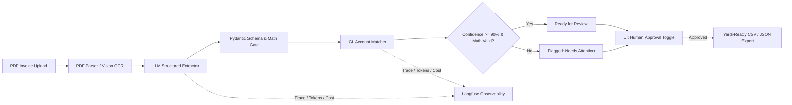

# CRE-Agent — Technical & Functional Specification

## 1. System Architecture



---

## 2. Core Functional Requirements

### 2.1 Invoice Ingestion
- Accept uploaded `.pdf` files (single or multi-page commercial vendor invoices, e.g., HVAC maintenance, commercial roof repair, landscaping).
- Support both text-based PDFs (extracted via `pymupdf` / `pdfplumber`) and scanned image PDFs (converted to base64 PNGs for Vision LLM extraction).

### 2.2 Structured Data Extraction
Extract and validate the following fields from every invoice:
- `vendor_name` (string)
- `invoice_number` (string)
- `invoice_date` (ISO date `YYYY-MM-DD`)
- `due_date` (optional ISO date `YYYY-MM-DD`)
- `property_address` (string)
- `line_items` (list of objects: `description`, `quantity`, `unit_price`, `line_total`)
- `subtotal` (float)
- `tax_amount` (float, default `0.0`)
- `amount_due` (float)
- `extraction_confidence` (float `0.0` to `1.0`)

### 2.3 Validation & Arithmetic Gates (Anti-Hallucination)
Before presenting results to the user, run deterministic Python checks:
1. **Line-Item Math Check:** Verify `abs(sum(item.line_total for item in line_items) + tax_amount - amount_due) <= 0.02`.
2. **Required Fields Check:** Ensure `vendor_name`, `invoice_number`, and `amount_due > 0` are present.
3. **Status Assignment:**
   - `VALID` if math passes and `extraction_confidence >= 0.90`.
   - `NEEDS_REVIEW` if math fails or `extraction_confidence < 0.90` (surface exact warning reason in UI).

### 2.4 GL Account Coding Assistant (Mock Chart of Accounts)
Match the invoice (and optionally individual line items) to the most appropriate CRE General Ledger (GL) code from a mock Chart of Accounts:

| GL Code | Account Name | Typical Vendor / Work Examples |
| :--- | :--- | :--- |
| `5100` | Property Taxes | County tax assessments, municipal property tax bills |
| `5200` | Property Insurance | General liability, commercial property/hazard insurance |
| `6100` | HVAC & Mechanical R&M | Chiller repair, rooftop unit (RTU) servicing, thermostat/ductwork |
| `6200` | Roofing & Building Exterior | Roof leak repair, membrane patching, gutter/flashing work |
| `6300` | Landscaping & Grounds | Lawn care, irrigation, parking lot sweeping, snow removal |
| `6400` | Janitorial & Cleaning | Common area cleaning, porter services, waste/dumpster fees |
| `6500` | Utilities (Electric/Water/Gas) | Municipal water, commercial electric, natural gas |
| `6600` | Security & Fire/Life Safety | Alarm monitoring, sprinkler inspection, fire extinguisher service |
| `7100` | Legal & Professional Fees | Lease drafting, eviction counsel, CPA/audit services |

**Output Requirements for GL Match:**
- `gl_code` (string, e.g., `"6100"`)
- `gl_account_name` (string, e.g., `"HVAC & Mechanical R&M"`)
- `gl_confidence` (float `0.0` to `1.0`)
- `explanation` (concise 1–2 sentence rationale referencing invoice line items)

### 2.5 Human-in-the-Loop (HITL) Approval & Yardi Export
- Display extracted invoice fields, validation badges (green `Math Verified` / amber `Needs Review`), and the recommended GL code + explanation.
- Allow the reviewer to override the GL code via a dropdown if needed.
- **Human Approval Toggle:** The **Export Yardi Payload** action remains locked/disabled until the user explicitly toggles **"Human Approval: Approved"**.
- Once approved, generate:
  1. **Yardi-Ready CSV** (downloadable `.csv` formatted for batch AP import).
  2. **Yardi-Ready JSON Payload** (viewable & downloadable `.json` with audit metadata: `approved_by`, `approved_at`, `langfuse_trace_id`).

---

## 3. Pydantic Data Models (Specification)

```python
from datetime import date, datetime
from typing import List, Optional, Literal
from pydantic import BaseModel, Field

class InvoiceLineItem(BaseModel):
    description: str
    quantity: float = 1.0
    unit_price: float
    line_total: float

class ExtractedInvoice(BaseModel):
    vendor_name: str
    invoice_number: str
    invoice_date: date
    due_date: Optional[date] = None
    property_address: str
    line_items: List[InvoiceLineItem]
    subtotal: float
    tax_amount: float = 0.0
    amount_due: float
    extraction_confidence: float = Field(ge=0.0, le=1.0)

class GLRecommendation(BaseModel):
    gl_code: str
    gl_account_name: str
    gl_confidence: float = Field(ge=0.0, le=1.0)
    explanation: str

class ValidationReport(BaseModel):
    math_valid: bool
    math_discrepancy: float = 0.0
    status: Literal["VALID", "NEEDS_REVIEW"]
    warnings: List[str] = []

class InvoiceAnalysisResponse(BaseModel):
    trace_id: Optional[str] = None
    invoice: ExtractedInvoice
    gl_recommendation: GLRecommendation
    validation: ValidationReport

class YardiExportPayload(BaseModel):
    batch_id: str
    vendor_name: str
    invoice_number: str
    invoice_date: date
    property_address: str
    gl_code: str
    gl_account_name: str
    amount_due: float
    human_approved: bool
    approved_at: datetime
    langfuse_trace_id: Optional[str] = None
```

---

## 4. API Endpoints (FastAPI)

| Method | Endpoint | Description |
| :--- | :--- | :--- |
| `GET` | `/health` | Health check returning service status and model config |
| `GET` | `/api/v1/chart-of-accounts` | Returns the mock CRE Chart of Accounts JSON |
| `POST` | `/api/v1/invoices/analyze` | Accepts `multipart/form-data` PDF, runs extraction + math gate + GL matching, returns `InvoiceAnalysisResponse` |
| `POST` | `/api/v1/invoices/export` | Accepts approved `YardiExportPayload`, validates `human_approved == True`, returns Yardi CSV & JSON |

---

## 5. Observability & Cost Control (Langfuse)

Every `/api/v1/invoices/analyze` request creates a **single parent Langfuse Trace** containing two child spans/generations:
1. `invoice_extraction`: Tracks model name, input/output tokens, latency, and extraction confidence.
2. `gl_coding_match`: Tracks model name, token usage, latency, and selected GL code.

**Cost Optimization Strategy:**
- Use `gpt-4o-mini` / `claude-3-5-haiku` for text-based PDFs and GL matching.
- Escalate to `gpt-4o` / `claude-3-5-sonnet` only when scanned/image OCR is required.

---

## 6. Yardi Export Format (Mock Batch CSV)

```csv
BatchID,VendorName,InvoiceNumber,InvoiceDate,PropertyAddress,GLCode,GLAccountName,AmountDue,ApprovedAt,TraceID
BATCH-20261125-001,"Apex Commercial HVAC LLC","INV-88412","2026-11-10","4500 Commerce Park Dr, Dallas, TX","6100","HVAC & Mechanical R&M",2450.00,"2026-11-25T12:30:00Z","lf-trace-98a12b"
```

---

## 7. 4–8 Hour Build Roadmap

- **Hour 1 — Project Setup & Schemas:** Initialize Python venv, install FastAPI, Pydantic, PyMuPDF, OpenAI/Anthropic SDK, Langfuse, Streamlit. Implement `models.py` and `chart_of_accounts.json`.
- **Hour 2 — Extraction & Math Gate:** Build PDF text/image extraction + LLM structured output call + deterministic arithmetic validation gate.
- **Hour 3 — GL Coding & Langfuse:** Implement GL matching prompt + Langfuse trace/generation logging.
- **Hour 4 — FastAPI Endpoints:** Wire `/analyze`, `/export`, and `/chart-of-accounts` endpoints with proper error handling.
- **Hour 5 — UI & HITL Toggle:** Build Streamlit UI with PDF upload, validation badges, GL override dropdown, **Human Approval** toggle, and CSV/JSON download buttons.
- **Hour 6 — Sample Invoices & Polish:** Create 2–3 realistic sample CRE PDF invoices (HVAC, Roofing, Landscaping) and test end-to-end.
